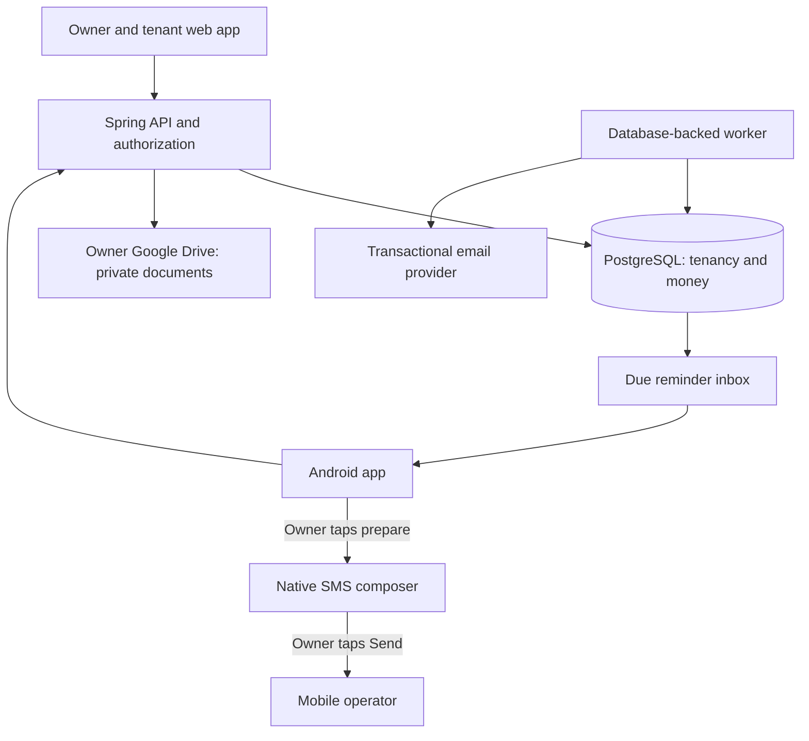
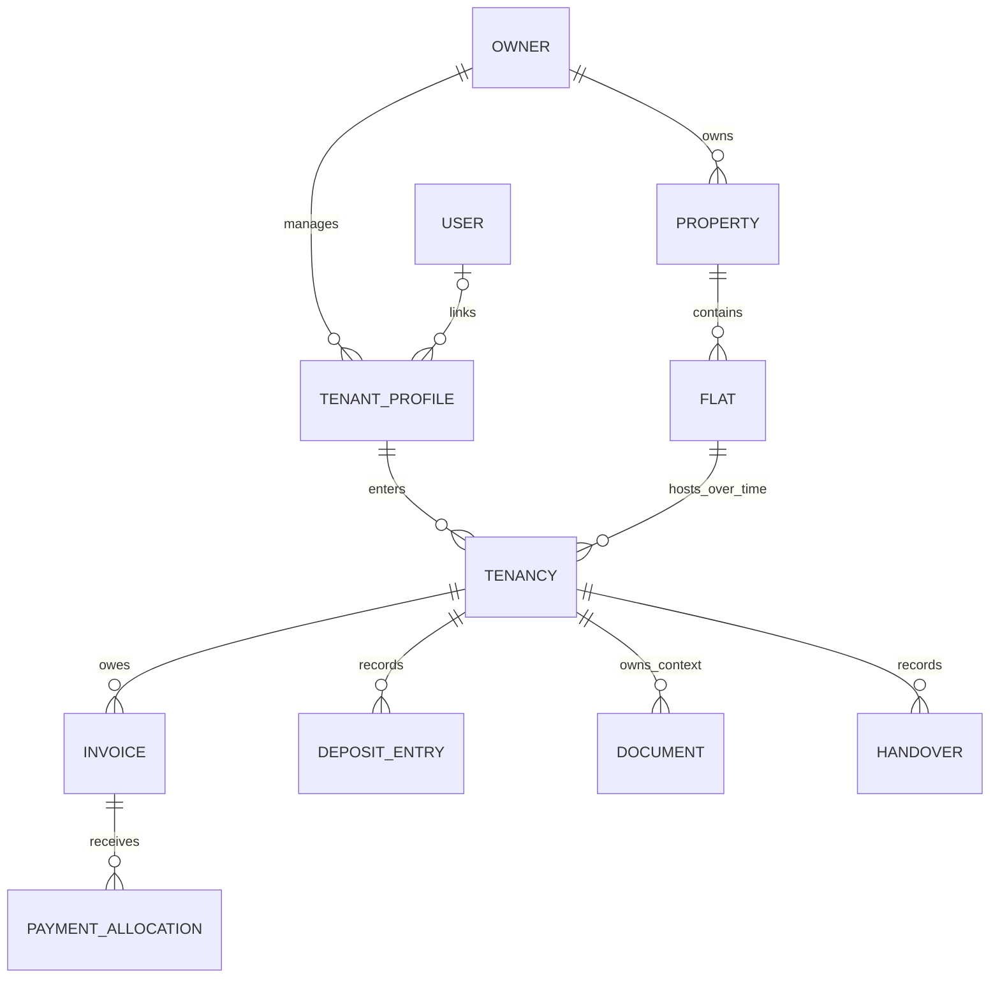
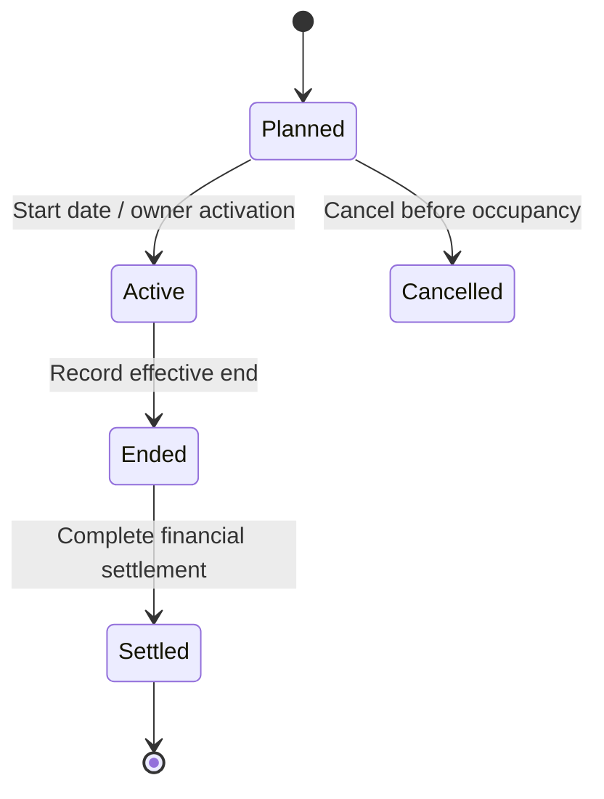
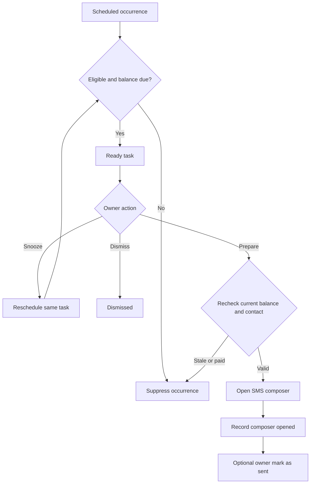
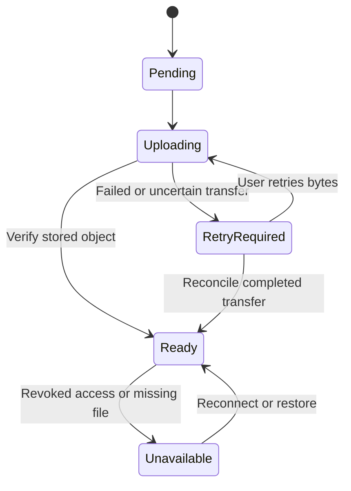

# Owner and Tenant Rental Platform - Plan

## Goal Capsule

**Objective:** An owner can manage a flat from tenant onboarding through monthly rent collection and move-out, while tenants can join, provide their documents, and see what they owe.

**Means:** Extend the existing Spring Boot, PostgreSQL, Vue, and Android application using KTD1-KTD12. Use the selected Drive storage split and owner-operated SMS flow in R10-R11 and R20.

**Authority:** The user's current rental workflow and explicit storage choice govern product behavior. This plan supersedes conflicting scope statements in the older PRD and root plans, including exclusions of tenant access. Existing financial records and access boundaries remain constraints during migration.

**Execution profile:** Deliver the six milestones below in dependency order. A milestone may contain several focused changes; do not ship the entire roadmap as one unreviewed change. This document authorizes planning only. Implementation, paid services, real messages, production migrations, and deployment require their own execution instruction.

**Stop conditions:** Stop an affected migration when owner attribution is ambiguous, financial reconciliation fails, or a proposed change would erase unverified source documents. Keep unrelated implementation work moving. Do not resolve these conditions by guessing ownership, deleting balances, or substituting public file links.

**Completion ownership:** The implementer supplies the verification evidence and release notes; the owner supplies the Google OAuth project, email domain/provider credentials, deployment settings, and any required government form template before the corresponding production capability is enabled.

---

## Product Contract

### Summary

Add owner registration, flat setup, tenant invitations and self-service, dated rent and utility terms, condition and handover records, recurring billing, and configurable reminders. Keep full NID details and uploaded documents in each owner's Google Drive. Store phone numbers encrypted in the application database. Let owners prepare SMS messages in the app and send them through their phone's messaging app.

### Problem Frame

The application already manages properties, tenants, invoices, payments, deposits, and expenses, but several workflows stop at owner-entered records. It cannot yet support the requested tenant signup and document flow. Mock notification records look like delivery, and automatic monthly billing is absent. Existing ownership checks and financial calculations also need correction before exposing the application to unrelated owners and tenant accounts.

### Current Coverage

| Capability | Present state | Required change |
|---|---|---|
| Owner account | Login and bootstrap accounts | Public owner signup, email verification, usable recovery |
| Flat | Property and unit CRUD | Simpler single-flat onboarding; optional rooms, bedrooms, bathrooms, furnishing |
| Rent and utilities | Tenant monthly rent and invoice utility entries | Effective dates, recurring defaults, monthly variable charges |
| Tenant | Owner-created profile and unit history | Separate tenancy, invitation redemption, account linking and tenant portal |
| NID and phone | Encrypted text fields; NID image in database | Drive NID storage, protected reads, phone encryption without plaintext copies |
| Government form | No dedicated workflow | Template download, completed file upload, review and version history |
| Handover | Assignment start/end dates | Condition checklist, photos, actual dates, acknowledgments and settlement |
| Monthly bills | Manual single and bulk creation | Durable automatic generation, missing-input tasks and catch-up |
| Debt | Outstanding invoices and aging | Correct totals, missing-bill visibility, consistent partial payment and arrears behavior |
| Notifications | Mock SMS events and manual overdue action | Honest reminder states, configured schedules and SMS preparation |
| Android SMS | Existing SMS composer intent | Reuse it with current balances, reminder tasks and error handling |
| Email | No actual delivery service | Account emails first; optional tenant reminders and receipts later |

Evidence is in the source references in the Appendix. “Present” indicates source coverage, not production readiness.

### Key Decisions

- **Use Drive for NID documents/details and encrypted server storage for phone numbers.** Governs R10-R11. (session-settled: user-directed — chosen over storing both only in Drive: SMS preparation must remain usable when Drive is disconnected.)
- **Use the owner's messaging app for SMS.** Governs R20. (session-settled: user-directed — chosen over a paid automatic SMS gateway: expected message volume is low and the owner can send from their own mobile.)
- **A valid invitation automatically joins the intended tenancy.** Governs R7-R8. The requested signup flow does not add a second owner-approval gate after code redemption.

### Actors

- A1. Owner: manages their own properties, tenancies, charges, documents and reminders.
- A2. Tenant: manages their own account and permitted profile fields, uploads their documents, views their own bills and receipts, and responds to handover records.
- A3. Manager: an existing role retained only for explicitly assigned properties; no identity-document access by default.
- A4. Application worker: generates bills and reminder tasks under a specific owner and tenancy scope.

### Requirements

**Accounts and access**

- R1. An owner can sign up with name, email and password, verify their email, sign in, reset a forgotten password and manage sessions. Server-side role assignment prevents signup as a manager or privileged account.
- R2. Every read and mutation enforces owner/property/tenancy membership, including documents, history, exports, dashboard totals and background work. A tenant never gains owner permissions by changing request fields.
- R3. Disabled accounts, revoked sessions and password resets invalidate the affected sessions; clients recover from ordinary access-token expiry without losing an in-progress form.

**Flats and tenancy**

- R4. An owner can create one flat with a building/address and flat identifier, then optionally add room, bedroom and bathroom counts, floor, area, furnishing and notes. A building can contain several flats without forcing a single-flat owner through bulk property setup.
- R5. Owners can set flat rent and recurring utilities with effective dates; a tenancy may override the flat defaults. Issued invoices keep their original charge snapshots when future terms change.
- R6. Utilities support fixed recurring amounts and owner-entered monthly amounts; missing monthly input is shown as pending, never silently treated as zero. Meter readings and automatic consumption calculations are follow-up work.
- R7. An owner can create a tenant and tenancy without requiring the tenant to have an account. A code can later link that existing record, or fill an owner-prepared tenancy slot, without making a duplicate tenant.
- R8. A signed-in or newly registered tenant can redeem an unexpired, unused flat invitation and automatically join its designated tenancy. Redemption is single-use, revocable and safe against simultaneous claims.
- R9. Tenants can view their own tenancy, charges, payment history, receipts and document checklist, and edit permitted contact details. Tenants cannot edit rent, owner-recorded payments, another tenant's records or financial settlement.

**Identity documents and handover**

- R10. Full NID number/details, NID images and completed registration forms are stored in the owner's connected Google Drive. The server retains only the metadata needed to locate, authorize, version and report on those records; document payloads and full NID values must not remain in database fields, logs, exports or backups created after migration cleanup.
- R11. Tenant phone numbers, including secondary and emergency contact numbers, remain encrypted on the server. Routine lists and logs use masked values; authorized SMS preparation can retrieve the required number.
- R12. Owners and tenants can upload NID images and completed government registration forms; owners can supply a blank form template. Track missing, uploaded, accepted and replacement-requested states without representing owner review as government verification.
- R13. Record planned and actual move-in/move-out handover dates, condition notes, room/checklist items, meter readings, keys/items handed over and photos. Preserve who recorded or acknowledged each version, including disagreements and an unacknowledged state.
- R14. Ending a tenancy preserves its bills, documents, condition history and deposit settlement, and does not alter a replacement tenancy occupying the same flat. Previous tenants retain their own historical bills and receipts, but no access to later occupants.

**Billing and money**

- R15. Each active tenancy can generate one bill per configured monthly billing period automatically, with owner-controlled issue and due days. Restarting or retrying a job cannot duplicate a bill.
- R16. Unpaid balances survive month changes as the original debt; display current charges and prior arrears separately. Missing bills are shown separately from known debt so the dashboard does not invent an amount or hide an unbilled month.
- R17. Support dated payments, partial payments, oldest-due-first allocation, receipts and explicit reversal/correction with reasons. Duplicate submissions and concurrent requests cannot collect the same balance twice.
- R18. Maintain a reconciled deposit ledger for opening deposits, receipts, deductions, refunds and reversals. Applying a deposit to rent is an explicit owner action with linked ledger entries.
- R19. Show billed rent, money actually collected, current and overdue outstanding, partial payments, unbilled months and vacant flats. Include expenses and cash received minus recorded expenses with labels that distinguish cash flow from profit.

**Reminders and daily use**

- R20. Owners configure reminder offsets and time of day, receive due tasks, preview current recipient/text and open the native SMS composer. The owner sends the message; the application distinguishes composer-opened, owner-marked-sent and actual provider delivery, and does not claim delivery for native SMS.
- R21. Reminder eligibility is recalculated against current debt, tenant contact preferences and tenancy status. Paid, cancelled or void bills generate no new debt reminders; owners can snooze or dismiss a task without changing the debt.
- R22. Optional email reminders and receipts use the tenant's provided email and preference, a verified sender and a bounded delivery queue. Quota or delivery failures are visible, and do not prevent payment recording or SMS preparation.
- R23. Provide searchable, paginated flat, tenant, invoice and reminder lists, with useful empty states and next actions. Correct slow-response form races and preserve entered values on recoverable errors.
- R24. Owner and tenant core flows work in the responsive web app and Android app, with English/Bangla labels, readable money/dates, accessible controls and PDFs that render Bengali names correctly.

**Data operations**

- R25. Protect phone encryption keys, Google refresh tokens and authentication secrets; record privacy-safe access/change events. Owners can export their records and request account/data deletion with the scope and consequences shown before deletion.
- R26. Release with database migration checks, financial reconciliation, a tested backup/restore path and visible job failures. A disconnected Drive account does not stop billing, payment recording or SMS preparation.

### Key Flows

- F1. Owner verifies account, creates a flat, sets terms, and creates or invites a tenant (R1, R4-R8).
- F2. Tenant redeems the code, checks their tenancy, completes profile fields, and uploads the required documents into the owner's connected Drive (R8-R12).
- F3. A billing period arrives, the worker creates a bill or flags missing input, the dashboard displays debt, and a payment reduces that debt with a receipt (R15-R19).
- F4. A configured reminder becomes due, the owner previews it, opens their SMS app and sends it themselves (R20-R21).
- F5. Owner and tenant record handover, the owner settles money, the tenancy ends, and a new occupant starts with separate history (R13-R14, R18).

### Acceptance Examples

- AE1. Covers R1, R4: an owner registers and creates “Flat 3B” without entering room counts; the flat is usable immediately after the required account verification.
- AE2. Covers R2, R10-R11: owner B cannot read owner A's tenant, phone, NID, Drive file, ledger or export by substituting an ID; a tenant cannot read another tenant's document.
- AE3. Covers R7-R8: an owner adds a tenant, then the tenant redeems its code; one profile and one tenancy remain. Two different accounts racing to redeem one code yield one success.
- AE4. Covers R5-R6: rent changes from BDT 15,000 to BDT 16,000 effective November 1. The October bill stays BDT 15,000; a November variable water charge remains visibly pending until entered.
- AE5. Covers R16-R17: October rent is BDT 15,000 and BDT 10,000 is paid. November adds BDT 15,000, so total debt is BDT 20,000. A BDT 8,000 payment clears October's BDT 5,000 first and leaves BDT 12,000 for November.
- AE6. Covers R10, R12, R26: Drive disconnects during an upload; the UI shows incomplete upload, no completed-document badge appears, and existing rent payments and SMS preparation still work.
- AE7. Covers R20-R21: a reminder is due, but payment clears the invoice before the owner taps it. The app suppresses the obsolete reminder. Cancelling the SMS composer never changes the task to delivered.
- AE8. Covers R13-R14: tenant A leaves and tenant B moves in. Repeating A's move-out action neither vacates B's tenancy nor exposes B's handover photos to A.
- AE9. Covers R15, R26: the worker restarts after creating a bill but before marking its job complete; retry finds the same bill instead of creating a second one.
- AE10. Covers R18-R19: a BDT 20,000 deposit received, BDT 3,000 deduction and BDT 17,000 refund reconcile to zero. A fully paid rent invoice still contributes to collected-income reporting.
- AE11. Covers R12, R24: a tenant uploads a completed PDF form and a Bengali-named tenant downloads a readable receipt; neither flow relies on government API access.

### Scope Boundaries

The six milestones are the planned product. The optional-email milestone can ship after the SMS workflow; registration and recovery email remain required earlier.

**Working assumptions:** Bangladesh, BDT and Asia/Dhaka are the initial business defaults. One primary tenant holds each active tenancy. Tenant accounts use verified email/password; owner-created tenants need neither an email nor an account. A tenant's phone is a contact field, not an SMS-OTP login dependency. These are implementation defaults, not claims about legal requirements.

**Deferred to Follow-Up Work**

| Improvement | Value | Suggested order / trigger |
|---|---|---|
| Maintenance requests with photos and resolution history | Makes the tenant portal useful between payments | Next after stable core operations |
| Lease-expiry, renewal and rent-review reminders | Prevents missed renewals | After tenancy dates and reminder worker are proven |
| Tenant payment-proof submission | Helps reconcile bank/bKash/Nagad transfers | Add owner approval; proof must never automatically mark a bill paid |
| Metered utilities and shared-bill splitting | Reduces repeated calculations for larger buildings | When actual allocation rules are available |
| CSV import with preview and duplicate detection | Speeds onboarding existing portfolios | After the new schema and owner attribution stabilize |
| Property-scoped manager invitation and permissions UI | Supports delegated operation | After deny-by-default manager enforcement |
| Passkeys or owner two-factor authentication | Protects access to sensitive tenant records | After recovery and sessions are reliable |
| Calendar view, renewal letters and document expiry reminders | Reduces owner administration | When the owner identifies the actual documents and dates |
| PWA install, push delivery and selected offline read access | Improves reach and connectivity tolerance | After measuring whether in-app and Android reminders suffice |
| Payment gateway integration | Automates payment confirmation | Only when volume justifies fees and reconciliation work |

**Considered and not built:** automatic background SMS sending, delivery-reading permissions, group SMS, government identity verification/submission, legal e-signatures, public property listings, AI tenant scoring, full offline writes, microservices and a general plugin framework. None is required for the requested owner workflow. Reconsider only with a concrete workflow and operating requirement.

### Deferred External Inputs

- The owner supplies the exact blank government form and any jurisdiction/version label. Generic completed-file upload can ship first; the application must not invent an official form or claim submission to authorities.
- Production OAuth credentials, consent branding, email-domain verification and deployed callback URLs are release prerequisites, not prerequisites to implementing those integrations.
- The owner chooses document retention and account-closure handling before enabling automatic deletion. Until then, provide explicit record-level deletion with consequences and audit metadata, and no automatic retention purge. Legal requirements require separate jurisdiction-specific review.

---

## Planning Contract

### Key Technical Decisions

- KTD1. **Keep the modular monolith.** Implement these workflows in the current Spring Boot/PostgreSQL backend, Vue frontend and Compose Android client (R1-R26). Reuse existing services and DTO conventions. A database-backed worker is enough for this volume; adding a broker or separate billing service adds operational work without solving a present need.
- KTD2. **Separate the person, account and tenancy.** Keep owner-scoped tenant profiles and optional user linkage; add a tenancy joining a profile to a flat, date interval and agreed terms (R7-R9, R14-R18). Invoices, deposits, documents and handovers point to the tenancy. A tenant-role account may link to different owner-scoped profiles without merging or exposing those owners' records. Preserve the current single account role initially: an owner/manager attempting tenant redemption receives an incompatible-account explanation and can use a tenant account; redemption never changes privileges. This avoids rewriting history when occupants move.
- KTD3. **Store effective terms and immutable issued charges.** Add dated flat defaults and tenancy overrides with non-overlapping effective intervals (R5-R6, R15). New terms default to the next unbilled period; backdating affects only unissued drafts and requires a preview. Use calendar-month billing initially, clamp configured day 29-31 to that month's last day, and calculate dates with an injected Asia/Dhaka business clock. Offer full-month or calendar-day proration for first/final months, with a displayed calculation and owner choice before issue. Missing variable utilities create a draft action; the owner may explicitly issue known charges and add a separately identified supplemental bill later. Primary and supplemental invoices have distinct uniqueness keys.
- KTD4. **Authorize at service and query boundaries.** Resolve ownership from stored relationships, never client-supplied owner IDs (R2). Explicit property assignments constrain managers, with sensitive-document permission separate from billing access. Existing managers without assignments receive no portfolio access. Tenant historical access follows their own tenancy even after move-out; document read/write permissions remain separate.
- KTD5. **Use owner OAuth with narrow file access.** Create a dedicated folder under the owner's My Drive using `drive.file`, rather than asking for access to every Drive file (R10). Bind OAuth state and PKCE to the authenticated owner and fixed callback. Encrypt refresh tokens with a versioned key; never expose them to tenants or mobile storage. Reject account replacement while documents are linked unless an explicit migration completes. A disconnected connection can be restored to the same Google account. [Google scopes](https://developers.google.com/workspace/drive/api/guides/api-specific-auth) and [OAuth server flow](https://developers.google.com/identity/protocols/oauth2/web-server) establish the access mechanism. (session-settled: user-directed — chosen over Drive-only contact storage: implements R10-R11 while retaining encrypted server phone access.)
- KTD6. **Treat Drive as the document store, with database metadata.** Store scans/forms/photos as ordinary private files and full NID details in a versioned JSON file under an opaque tenancy identifier (R10-R13). The server keeps file IDs, document kind/version, hash, timestamps, review state and owner/tenancy IDs, but no full NID or identity-bearing filenames. Authenticated backend routes stream authorized reads and validate uploads by content, size and type. Start with JPG/PNG/PDF, a 10 MiB per-file limit, and no executable/HTML/SVG content. The backend necessarily handles plaintext transiently; this is not end-to-end encryption against the application operator. Do not grant public or tenant-wide Drive folder access.
- KTD7. **Make cross-store uploads recoverable.** Create an upload record and stable Drive file ID before transfer, then mark ready only after verified completion (R10, R26). Bound transient buffers and concurrent uploads; disable multipart disk spooling for these bounded requests and redact request/APM payload capture. Failed uploads require explicit retry of bytes from the client; reconciliation checks whether an uncertain transfer completed. Never add a permanent database fallback containing document content. Replacements create new versions and preserve the prior ready version until completion. Compare the stored version/hash with the current Drive file before displaying it as reviewed or acknowledged; external edits require a new review and must be labeled changed outside the app. Record that original bytes are unavailable if the owner overwrote or deleted them; do not promise tamper-proof evidence or recoverability. Revocation, quota exhaustion and deleted files produce actionable states. Drive outages do not change payment state.
- KTD8. **Use transactional financial invariants.** Serialize payments/allocations/settlements through a consistent tenancy lock, persist idempotency keys with request hashes, and enforce database constraints (R15-R18). Use decimal BDT, round invoice lines to two decimals, and never floating-point money. Reverse posted entries with linked compensating records. Prevent overpayment in the initial release instead of silently discarding surplus. Keep opening deposits in the ledger; cancelled/void invoices contribute no receivable balance. Issued financial history cannot be changed by editing a tenant profile.
- KTD9. **Persist scheduled work and reminder tasks.** A Spring scheduled poller claims database jobs with leases, bounded retries and unique business keys; external calls run outside long database transactions (R15, R20-R22, R26). U3 introduces the minimal persistent runner for account email, and U12/U14/U16 reuse it for billing, reminders and exports. Startup catch-up creates missed periods after each tenancy's explicit automation-start date, and flags older gaps for review. Workers across multiple instances cannot duplicate a bill or task. Use a supported always-running deployment for timely scheduling; sleeping hosting cannot promise on-time processing.
- KTD10. **Extend the existing Android composer.** Use `ACTION_SENDTO`, `smsto:` and `sms_body` after an owner tap, with one recipient at a time (R20). No `SEND_SMS` or SMS-reading permission is needed for this design. Record open and owner-confirmed events separately; refresh balance/recipient before composing and never treat activity return as delivery. Android periodically fetches due tasks using WorkManager and posts a generic owner notification with a tap action; notification denial leaves the in-app inbox usable. WorkManager is inexact. Web offers supported `sms:` links and copy-number/copy-text fallback. [Android intents](https://developer.android.com/guide/components/intents-common#Messaging) and [work scheduling](https://developer.android.com/develop/background-work/background-tasks/persistent/getting-started/define-work) govern the platform integration. (session-settled: user-directed — chosen over automatic SMS dispatch: the owner sends using their mobile.)
- KTD11. **Use a small transactional email adapter.** Start with Resend for verification/recovery email and later optional tenant reminders (R1, R22). Store email preferences, use a verified application domain, reserve quota for authentication, and show deferred/failed sends. Configure daily/monthly limits below the chosen plan's caps; do not enable paid overages automatically. Use provider idempotency where available and verify webhook signatures before accepting delivery events. Keep full NID, attachments and private document links out of email.
- KTD12. **Introduce schema changes additively and reconcile before switching reads.** Backfill tenancy and ledger references with explicit ownership reports, then apply constraints and move callers (R14-R18, R25-R26). Keep old columns readable during migration. Source NID fields/blobs are removed only after per-record Drive verification and a recorded cleanup checkpoint. Older backups remain sensitive until their retention expires; changing the live database does not erase them. Reversible application rollback uses retained compatible columns; destructive cleanup is a later release with a verified restore plan.

### Data Boundaries

| Location | Stored information | Access rule |
|---|---|---|
| PostgreSQL | Users, owner-scoped profiles, tenancies, flats, terms, invoices, payments, deposits, expenses, reminder metadata | Owner/property/tenancy-scoped services |
| Encrypted PostgreSQL fields | Primary/secondary/emergency phone numbers; Google refresh credentials; export artifacts containing contact data | Decrypt only within authorized workflows; keys outside database |
| Owner's Drive | Full NID JSON, NID images, completed forms, form templates, handover photos | Backend uses owner's grant; application never creates public links |
| Database document metadata | Opaque file references, hashes, kind/version, review/upload state | Same tenancy scope as document |
| Logs and audit | Actor, action, record ID, timestamp, result and changed-field names | No full phone, NID, document content, token or reset code |
| Client memory | Authorized form fields and files while the operation is active | No identity-document offline cache; clear on logout/navigation as appropriate |

Owner-controlled storage means the owner owns the Drive files, not that the backend is unable to read them. Tenant upload can use the owner's server-held OAuth grant after application authorization; the tenant does not need a Google account. If the owner shares their folder manually in Drive, the app cannot prevent that outside action.

### High-Level Technical Design

The component and data flow follows KTD1, KTD5-KTD11:



The tenancy relationships preserve historical ownership (KTD2):



Invitation redemption is atomic; document readiness is separate from membership (R8, R12):

```mermaid
sequenceDiagram
  participant O as Owner
  participant A as Application
  participant T as Tenant
  participant D as Database
  O->>A: Prepare tenancy and create invitation
  A->>D: Store invitation hash and target tenancy
  O->>T: Share code or invitation link
  T->>A: Sign in and redeem code
  A->>D: Lock invitation and tenancy; validate and link account
  D-->>A: Commit one redemption
  A-->>T: Show flat, bills and document checklist
```

The tenancy lifecycle (R7-R8, R13-R14) distinguishes planned dates from occupancy. Account linking does not change tenancy dates:



Reminder actions and eligibility (R20-R21) are deliberately separate from SMS delivery:



The upload states prevent incomplete files from appearing accepted (KTD7):



### Detailed Workflow Rules

**Invitations:** Generate a high-entropy share link and a human-enterable random code. Store a keyed hash, not the code itself. Default expiry is 7 days; owner can revoke/regenerate. Rate-limit lookups and return generic invalid/expired responses without leaking tenant identity. Owner-created profile claims must be targeted to that profile; never auto-link by matching a phone or NID. Repeating successful redemption from the same account returns the existing result, while a different account fails. Users can see the intended flat and terms only after sufficient invitation validation, before completing redemption.

**Tenancy and pricing:** One active tenancy per flat is enforced in PostgreSQL; planned tenancies may not overlap another planned/active interval. Existing occupants can join an account without moving the lease date. Move-in records date and deposit explicitly. Ending occupancy can precede settlement: debt remains due after move-out, with reminder preferences reviewed at that transition. Moving to another flat closes one tenancy and creates another. Do not overwrite invoice tenancy or price history.

**Invoices:** Treat existing `SENT` as issued, not proof of message delivery; display “Issued” and plan an explicit API compatibility mapping. Drafts do not count as collectible debt. Compute overdue from issued/partially-paid positive balance and due date, so missing a status-update job cannot hide overdue debt. Late fees remain opt-in and snapshot their configured rule, with a preview and explicit waiver/reversal. Do not automatically invent penalty rates, evict tenants or compound unpaid rent. Supplemental charges remain linked to the same billing period without duplicating the primary rent invoice.

**Reminder policy:** Default due-day time is 09:00 Asia/Dhaka; offer editable offsets such as 3 days before, due day, 3 days after and 7 days after. Preserve a unique occurrence key per owner/tenancy/bill/channel/rule/date. Editing policy changes future occurrences; it does not replay completed ones. Group multiple overdue bills for one tenant into one current debt summary at composition time. After downtime, coalesce obsolete occurrences into one current actionable task per tenant/channel. Persist references and template version, not a plaintext phone or NID in notification payloads. Prepare each SMS separately; never expose multiple tenants' numbers in a group message.

**Documents:** Owner and tenant can view documents belonging to their tenancy through authenticated routes; an ended tenant retains read access to their own submitted identity/form versions until deletion, but cannot replace them. Owner review and tenant acknowledgment are application records, not signatures or identity certification. Initially validate NID as a non-empty bounded identifier without claiming official verification; do not silently retain the current 17-digit-only rule without an authoritative product requirement. Strip image metadata where practical, force attachment download for original PDFs, and render only sanitized image previews. Downloads use `no-store` and safe content-disposition headers.

**Disconnect and deletion:** Disconnect removes/revokes the application grant and leaves Drive files with the owner. Document deletion is a separate explicit action showing which versions and Drive files will be removed. If access is revoked, report deletion as pending owner action rather than claiming success. Owner account closure first offers an export and chooses retention versus Drive-file deletion. Remove credentials, stop jobs and unlink tenant access as part of closure; retain only explicitly justified audit metadata. No automatic document retention duration is asserted by this plan.

### Cost and Operating Assumptions

| Component | Expected low-volume cost | Important limit |
|---|---|---|
| Native SMS preparation | No SMS gateway subscription or per-call API charge | Owner's SIM/package pays for actual SMS; sending remains manual |
| SMS text length | Short templates reduce segments | Typical GSM-7 single SMS is 160 units; Unicode is 70, with lower multipart limits |
| Drive API | Standard usage currently has no additional API charge | Google documents quota/billing changes planned for later 2026; recheck before launch |
| Drive storage | Uses the owner's existing storage allowance | Full Drive quota can prevent uploads; owner may need more storage |
| Transactional email | Resend currently lists 3,000/month and 100/day free | Shared application quota, not per owner; sender domain and hosting have separate costs |
| Server/database | Existing deployment still required | Drive does not replace the application database or worker hosting |

Sources: [SMS encoding](https://www.twilio.com/docs/glossary/what-sms-character-limit), [Drive limits/pricing](https://developers.google.com/workspace/drive/api/guides/limits), [Drive file ownership](https://developers.google.com/workspace/drive/api/guides/create-file), [Resend pricing](https://resend.com/pricing). Checked October 1, 2026. Bengali text, the taka symbol and many emoji require Unicode encoding; the SMS app/operator determines actual segmentation and charges. No specific Bangladesh operator tariff is assumed.

For example, 10 tenants receiving 3 single-segment reminders require 30 billable SMS segments, multiplied by the owner's actual tariff. A two-segment message doubles that segment count. Show a segment estimate in the preview, with an English compact template using `BDT` and an optional Bangla template; do not promise a currency price without the owner's mobile plan.

### Delivery Milestones

| Milestone | Units | Usable result and release gate |
|---|---|---|
| 1. Safe foundation | U1-U5 | Isolated owner data, reliable accounts, tenancy migration and reconciled money |
| 2. Flat and tenant onboarding | U6-U8 | Owner setup, secure invitation redemption and tenant portal |
| 3. Documents and handover | U9-U11 | Owner Drive connection, NID/forms and complete move-in/out records |
| 4. Monthly operations | U12-U14 | Automatic bills, trustworthy dashboard and configured SMS tasks |
| 5. Communication and records | U16; U15 optional | Bengali receipts and durable exports; optional tenant email can follow core release |
| 6. Release hardening | U17, U19, U18 | Verified clients, account closure, production configuration and restore rehearsal |

Migrations and relevant tests accompany every milestone; milestone 6 is the final release gate, not the first time testing happens. Backend prerequisites must ship before dependent client features are enabled.

---

## Implementation Units

New files below are proposed locations, not claims that they already exist. Allocate the next unused Flyway version at implementation time; retain migrations V1-V3 unchanged.

| Unit | Title | Primary files touched | Depends on |
|---|---|---|---|
| U1 | Ownership and privacy boundaries | `tenant/TenantService.java`, `common/AuditService.java` under backend Java root | None |
| U2 | Session lifecycle | Backend `security/`, `auth/`; web auth store; Android session store | U1 |
| U3 | Signup and account email | Backend `auth/`, new `email/`; registration views | U2 |
| U4 | Tenancy model and backfill | Backend `domain/tenant/`, repositories and migrations | U1 |
| U5 | Financial invariants | Invoice/deposit services and repositories | U4 |
| U6 | Flat details and charge terms | Property DTOs/service; new terms service | U4 |
| U7 | Tenant invitations | New invitation service; owner tenant UI | U3, U4, U6 |
| U8 | Tenant portal | New tenant routes/views and Android screens | U7 |
| U9 | Owner Drive connection | New storage integration and owner settings | U2 |
| U10 | Documents and NID migration | New document service; existing NID routes | U8, U9 |
| U11 | Condition and handover | New handover service and tenancy views | U5, U10 |
| U12 | Recurring bills | Invoice service; shared job runner and billing worker | U3, U5, U6 |
| U13 | Dashboard and query improvements | Dashboard repositories and web home/lists | U5, U12 |
| U14 | Reminder schedules and SMS | Notification service; Android composer/worker | U8, U12, U13 |
| U15 | Optional tenant email | Email queue, preferences and webhooks | U3, U14 |
| U16 | PDFs and exports | PDF/export services and download UI | U5, U10, U13 |
| U17 | Web and Android completion | Existing clients, split feature components | U8, U11, U14, U16 |
| U18 | Deployment and operations | CI, deployment config, migrations and runbooks | U1-U14, U16-U17, U19; U15 if enabled |
| U19 | Account closure and deletion requests | New account lifecycle service and settings | U10, U14, U16 |

### U1. Enforce ownership and remove plaintext audit exposure

**Goal:** Close cross-owner and cross-tenant data access before expanding signup.

**Requirements:** R2, R10-R11, R25; AE2. **Dependencies:** None.

**Files:** `backend/src/main/java/com/renteasebd/tenant/TenantService.java`, `tenant/TenantController.java`, `common/AuditService.java`, `notification/NotificationService.java`, affected controllers/services under `backend/src/main/java/com/renteasebd/`, new `security/ResourceAccessService.java` in that root, new `backend/src/test/java/com/renteasebd/security/ResourceIsolationTest.java` and `AuditPrivacyTest.java`.

**Approach:** Implement KTD4 across list, detail, mutation, history, NID, notification, dashboard, expense, deposit and export routes. Add manager/property assignment storage without opening manager self-registration. Replace audit serialization of entire tenant DTOs with allowed metadata. Stop new plaintext phone writes from every invoice/payment/move-out notification producer in this unit; persist tenant references and resolve an authorized recipient when needed. Remove historical plaintext phone copies from audit/notification data through a bounded migration with a retained count report. U14 later replaces the mock delivery semantics.

**Patterns:** Existing owner-scoped property checks and structured API errors. **Execution note:** Start with failing regression tests for the cross-owner read demonstrated by the earlier audit.

**Test scenarios:**

- Covers AE2: substitute tenant/document/export IDs across two owners and two tenants; every response denies access without leaking payload.
- An unassigned manager cannot enumerate all active properties.
- Creating/editing a tenant, issuing a bill, receiving payment and recording move-out leave no full phone, NID or document bytes in audit JSON or notification history.

**Verification:** A route-by-role access matrix passes against PostgreSQL, including direct service calls and asynchronous jobs.

### U2. Repair sessions and credential handling

**Goal:** Make session expiry, revocation and account disablement reliable.

**Requirements:** R3, R25. **Dependencies:** U1.

**Files:** `backend/src/main/java/com/renteasebd/auth/AuthService.java`, `backend/src/main/java/com/renteasebd/security/JwtAuthenticationFilter.java`, `AuthRateLimitFilter.java` in the same directory, `backend/src/main/java/com/renteasebd/security/AesGcmStringConverter.java`, `frontend/src/api.ts`, `frontend/src/stores/auth.ts`, `android-app/app/src/main/java/com/rentease/seniorrent/SessionStore.kt`, new `backend/src/test/java/com/renteasebd/auth/SessionLifecycleTest.java`, new `frontend/src/stores/auth.test.ts`.

**Approach:** Enforce account enablement and session revocation on authenticated requests. Rotate refresh tokens and reject reuse. Use short-lived access tokens, browser HttpOnly refresh cookies with CSRF protection, and Android Keystore-protected refresh storage excluded from backup. Serialize client refresh so simultaneous expired requests do not race. Introduce versioned encryption envelopes and a rotation procedure that can still decrypt older phone values. Preserve legacy refresh compatibility only during a defined client upgrade window.

**Patterns:** Existing refresh-token repository and session endpoints.

**Test scenarios:**

- Disable an account or revoke its session; its previously valid access token stops working.
- Two concurrent expired web requests refresh once and retry without duplicating a mutation.
- A reused refresh token is rejected; encrypted phone data remains readable across a staged key rotation.

**Verification:** Web and Android survive token expiry, logout and password reset without exposing refresh secrets or losing unrelated form data.

### U3. Add owner signup and real account email

**Goal:** Let owners register and recover access without a seeded account or logged reset code.

**Requirements:** R1, R3, R22. **Dependencies:** U2.

**Files:** `backend/src/main/java/com/renteasebd/auth/AuthController.java`, `AuthService.java` in that directory, new `backend/src/main/java/com/renteasebd/email/TransactionalEmailService.java`, new `backend/src/main/java/com/renteasebd/jobs/PersistentJobRunner.java`, job entity/repository and migration, new auth token entity/repository and Flyway migration, new `frontend/src/views/RegisterView.vue`, updates to `frontend/src/views/LoginView.vue`, new `backend/src/test/java/com/renteasebd/auth/RegistrationRecoveryTest.java`, new `backend/src/test/java/com/renteasebd/jobs/PersistentJobRunnerTest.java`, new `frontend/src/views/RegisterView.test.ts`.

**Approach:** Apply KTD11 initially to signup verification and password reset. Persist hashed, expiring, single-use verification/reset tokens; never log token values. Introduce the small job table/poller in KTD9 here and enqueue delivery after commit with authentication priority and a visible resend path. Keep handlers concrete for the known email/billing/reminder/export jobs, without a workflow framework. Normalize email uniqueness, return enumeration-safe recovery responses, and rate-limit signup, login and resend. Reuse these primitives for tenant account creation in U7.

**Patterns:** Existing password hashing, auth DTO validation and API envelopes.

**Test scenarios:**

- Covers AE1: new owner verifies email and can proceed to flat creation.
- Duplicate email, expired/used token and attempted privileged role assignment are rejected appropriately.
- Email outage leaves a pending account and retry option; it does not create a misleading verified account or expose reset codes.
- Restarting after a provider timeout preserves the queued account email and uses the same provider idempotency key on retry.

**Verification:** A real test mailbox receives account emails from the configured test sender; provider failures are covered with stubs and do not require live sends in ordinary CI.

### U4. Add tenancy records and migrate existing history

**Goal:** Preserve occupant, flat and financial history independently of editable profiles.

**Requirements:** R7-R9, R14-R18. **Dependencies:** U1.

**Files:** New `backend/src/main/java/com/renteasebd/domain/tenant/Tenancy.java`, `backend/src/main/java/com/renteasebd/tenant/TenancyService.java`, tenancy repository, updates to `domain/tenant/Tenant.java` and `TenantUnitHistory.java` under the same backend Java root, additive migrations in `backend/src/main/resources/db/migration/`, new `backend/src/test/java/com/renteasebd/tenant/TenancyMigrationTest.java` and `TenancyLifecycleTest.java`.

**Approach:** Implement KTD2 and KTD12. Derive owner from property/unit history, backfill tenancy references and preserve historical invoice dates. Produce exceptions for ambiguous old assignments rather than guessing. Enforce one active occupancy and non-overlapping planned intervals. Make end/move operations idempotent and derive unit availability from actual active tenancy, not a stale tenant status update.

**Patterns:** Existing tenant-unit history and Flyway migrations.

**Test scenarios:**

- Covers AE8: repeat move-out for a previous tenant after a replacement occupies the flat; replacement remains active.
- An existing invoice remains associated with its historical owner/tenancy after a move.
- Two concurrent attempts to activate the same flat cannot both succeed; ambiguous migration rows are reported.

**Verification:** Counts, owners, date ranges and invoice/deposit references reconcile before switching reads; migration runs against real PostgreSQL.

### U5. Make payments, deposits and balances consistent

**Goal:** Eliminate duplicate collections and reconcile every displayed balance.

**Requirements:** R16-R19, R25-R26; AE5, AE10. **Dependencies:** U4.

**Files:** `backend/src/main/java/com/renteasebd/invoice/InvoiceService.java`, `backend/src/main/java/com/renteasebd/deposit/DepositService.java`, invoice/payment/deposit repositories and entities, related DTOs, new financial migrations, existing `backend/src/test/java/com/renteasebd/invoice/InvoiceServicePaymentTest.java` and `backend/src/test/java/com/renteasebd/deposit/DepositServiceBoundsTest.java`, new `PaymentConcurrencyTest.java` and `DepositReconciliationTest.java` in their corresponding test packages.

**Approach:** Apply KTD8. Add idempotent direct/FIFO payment and settlement commands, a consistent lock order, database checks and explicit reversal endpoints. Backfill opening deposit entries exactly once after comparing stored opening amounts with recorded transactions. Fix cancelled/void receivables and distinguish effective payment date from record creation date. Update payment/deposit UI to show allocation preview, receipt and correction reason.

**Patterns:** Existing allocation response DTOs and transaction services. **Execution note:** Convert the audit's bad-balance/concurrency findings into regression tests before changing calculations.

**Test scenarios:**

- Covers AE5 and AE10: reproduce the full arrears and deposit examples with exact ledger totals.
- Concurrent direct and FIFO payments cannot exceed an invoice balance; repeated idempotency key returns the original result and changed payload conflicts.
- Reversing a payment restores debt once; cancelled/void invoices contribute zero collectible balance.
- Existing deposit transactions plus a legacy opening value do not get counted twice during migration.

**Verification:** Invoice, tenant ledger, deposit ledger and dashboard query totals reconcile using the same posted records under PostgreSQL concurrency tests.

### U6. Add flat details and dated charge terms

**Goal:** Make rent and utility setup reusable and safe to change.

**Requirements:** R4-R6, R15; AE1, AE4. **Dependencies:** U4.

**Files:** `backend/src/main/java/com/renteasebd/property/dto/UpsertUnitRequest.java`, `CreatePropertyRequest.java` and `UpdatePropertyRequest.java` in that directory, `backend/src/main/java/com/renteasebd/property/PropertyService.java`, property schema migration, new charge-term entities/service/migrations under backend, `frontend/src/views/PropertiesView.vue`, `PropertyUnitsView.vue` and `PropertySettingsView.vue` in the same directory, new `backend/src/test/java/com/renteasebd/property/ChargeTermsTest.java`, new `frontend/src/views/PropertyUnitsView.test.ts`.

**Approach:** Extend existing units as flats, preserving API compatibility for old optional fields. Add the optional detail fields and a short single-flat setup flow. Relax separate thana/district/division metadata for this address-first flow instead of inventing values; keep supplied legacy values and validate them when present. Default the property type to residential and derive the single-flat unit count, retaining explicit multi-unit setup. Implement KTD3 with dated terms, tenancy overrides, recurring fixed versus monthly input flags, and a price-change impact preview. Validate counts and monetary inputs without making optional metadata mandatory.

**Patterns:** Existing property settings and utility configuration DTOs.

**Test scenarios:**

- Covers AE1: create a flat using its address and identifier without counts, area or separate location metadata; optional missing values remain unknown rather than zero or fabricated text.
- Covers AE4: a future rent edit changes the correct next bill and leaves an issued bill untouched.
- Overlapping term intervals are rejected; a February due day 31 clamps correctly, including leap years.
- Proration preview and issued line use the same date range and rounding.

**Verification:** An owner can create and later change rent/utilities without rewriting historical statements.

### U7. Implement tenant invitations and profile claiming

**Goal:** Support owner-created tenants and automatic code-based joining without duplicates.

**Requirements:** R7-R8; F1-F2, AE3. **Dependencies:** U3, U4, U6.

**Files:** New `backend/src/main/java/com/renteasebd/tenant/InvitationService.java`, invitation controller/entity/repository/migration, updates to `TenantService.java`, `frontend/src/views/TenantsView.vue`, new `frontend/src/views/JoinFlatView.vue`, new `backend/src/test/java/com/renteasebd/tenant/InvitationRedemptionTest.java`, new `frontend/src/views/JoinFlatView.test.ts`.

**Approach:** Follow the invitation rules and KTD2/KTD4. Owner chooses an existing profile or prepares a new tenancy slot, then copies/shares its link or code. Account signup verifies email while preserving the pending invitation. Resolve role/profile conflicts explicitly; never merge across owners by matching a phone. Show join success and the document checklist immediately after atomic redemption.

**Patterns:** Existing auth validation and owner tenant creation.

**Test scenarios:**

- Covers AE3: existing profile claim creates no duplicate; competing claims produce one winner.
- Invalid, revoked and expired codes reveal no tenant details; repeat claim from the successful account is idempotent.
- Claiming a future tenancy links the account without marking it occupied today.
- A code intended for another owner cannot redirect a document upload or alter the invitation's target flat.
- Redeeming from an owner/manager account shows the incompatible-account path without changing its role or consuming the invitation.

**Verification:** Both owner-created and self-signup paths reach the same authoritative tenancy and account association.

### U8. Build the tenant portal

**Goal:** Give tenants a focused view of their own flat, bills and profile.

**Requirements:** R9, R14, R23-R24; F2. **Dependencies:** U7.

**Files:** New tenant-self controller/DTOs under `backend/src/main/java/com/renteasebd/tenant/`, new `frontend/src/views/TenantHomeView.vue` and `TenantProfileView.vue`, `frontend/src/router/index.ts`, proposed `android-app/app/src/main/java/com/rentease/seniorrent/tenant/TenantScreen.kt`, new `backend/src/test/java/com/renteasebd/tenant/TenantPortalAccessTest.java`, new `frontend/src/views/TenantHomeView.test.ts`.

**Approach:** Add role-appropriate navigation and narrow profile update DTOs. Use scoped API responses for active and past tenancies; show unpaid/current/history states and pending documents. U10 adds live upload actions to this checklist. Keep owner and tenant authorization server-enforced even when navigation hides actions.

**Patterns:** Existing Vue auth store/router and Compose API client.

**Test scenarios:**

- A tenant sees their own paid and unpaid bills, but cannot change rent or post an owner payment.
- A moved-out tenant can view their own receipt and cannot see the new occupant.
- Missing account-to-profile linkage yields a join-flat prompt rather than an owner dashboard.

**Verification:** The tenant journey works on web and Android without exposing owner-only API fields or actions.

### U9. Connect the owner's Google Drive

**Goal:** Establish a recoverable, least-privilege storage connection per owner.

**Requirements:** R10, R25-R26. **Dependencies:** U2.

**Files:** New `backend/src/main/java/com/renteasebd/storage/GoogleDriveConnectionService.java`, connection controller/entity/repository/migration, owner settings view/components in `frontend/src/`, new `backend/src/test/java/com/renteasebd/storage/DriveConnectionTest.java`, configuration additions in `backend/src/main/resources/application.yml`.

**Approach:** Apply KTD5. Use a reviewed Google OAuth client library, strict callback validation and a private app-created folder. Show connected account, connection state, reconnect and disconnect controls. Android starts the same secure browser flow and returns using a verified app link. Google credentials stay server-side. Configure production OAuth consent before public launch; testing-mode tokens are unsuitable for permanent operation.

**Patterns:** Existing application configuration and authenticated owner settings.

**Test scenarios:**

- OAuth callback with wrong, reused or expired state cannot link an account.
- An owner reconnects the same account without orphaning document metadata; switching accounts is blocked while linked files remain.
- Token revocation/quota errors create actionable connection states without changing invoice or phone access.

**Verification:** A dedicated test owner can create/read a private file in their own Drive, and a second owner's credentials cannot access it through the application.

### U10. Add documents and migrate NID storage

**Goal:** Store NID and registration documents according to the selected Drive/server split.

**Requirements:** R10-R12, R25-R26; AE2, AE6, AE11. **Dependencies:** U8, U9.

**Files:** New `backend/src/main/java/com/renteasebd/document/DocumentService.java` and controller, document metadata entities/repository/migrations, existing NID methods in `backend/src/main/java/com/renteasebd/tenant/TenantService.java`, new web/Android document components, new `backend/src/test/java/com/renteasebd/document/DocumentStorageTest.java` and `NidMigrationTest.java`, new `frontend/src/components/DocumentUpload.test.ts`.

**Approach:** Apply KTD6-KTD7/KTD12. Upload NID details JSON and files only to the authorized owner's storage destination. Add blank-template and completed-form actions, review/replacement history and scan capture from mobile. Migrate each connected owner's existing NID records with a manifest, verified hashes, resumable progress and explicit cleanup. Disconnected owners retain restricted legacy reads until migration; show migration-pending state and prevent new server-stored NID writes.

**Patterns:** Existing receipt content validation is a starting point; do not copy NID's MIME-header-only validation.

**Test scenarios:**

- Covers AE2/AE6/AE11: authorized tenant PDF upload succeeds, cross-tenant access fails and Drive outage never produces a ready badge.
- Retry after an uncertain network response discovers the original completed file instead of creating a duplicate.
- Oversized, executable or MIME-spoofed files are rejected before permanent storage.
- Crash midway through migration preserves unmigrated records; verified records are not uploaded again and cleanup never precedes verification.
- An accepted file is edited directly in Drive; the app shows an external-change state and does not attach the old review or handover acknowledgment to the new bytes.

**Verification:** Synthetic NID values disappear from the post-cleanup database/logs/exports; authorized reads still work through Drive. Verify transient multipart handling and backup retention separately from the live-data check.

### U11. Record condition, handover and settlement

**Goal:** Preserve move-in/out evidence and connect it to the correct tenancy.

**Requirements:** R13-R14, R18; F5, AE8. **Dependencies:** U5, U10.

**Files:** New `backend/src/main/java/com/renteasebd/tenant/HandoverService.java`, handover entities/repository/controller/migration, additions to tenant views and Android tenancy screens, new `backend/src/test/java/com/renteasebd/tenant/HandoverLifecycleTest.java`, new `frontend/src/components/HandoverForm.test.ts`.

**Approach:** Provide reusable room/item checklist entries, condition grades plus notes, actual/planned dates, key counts, meter readings and Drive photos. Publish a version for tenant acknowledgment or disagreement; edits create a new version. Connect final settlement to U5 ledger commands while keeping occupancy end independent of unpaid debt. Require a recorded reason for deposit deductions and allow evidence links.

**Patterns:** Existing move-out settlement and tenant history, refactored to use tenancy identity.

**Test scenarios:**

- Covers AE8: repeated old handover/end action cannot affect the replacement tenant.
- Owner changes a published checklist; the previous acknowledgment remains attached to the old version.
- Photo upload fails; the handover shows missing evidence instead of a broken completed attachment.
- Tenant disagreement is preserved and cannot mutate the owner's financial settlement.

**Verification:** The owner can inspect move-in versus move-out condition, dates, acknowledgments and money for each historical tenancy.

### U12. Generate monthly bills reliably

**Goal:** Create bills and expose missing billing work without duplicate charges.

**Requirements:** R5-R6, R15-R16, R26; F3, AE4, AE9. **Dependencies:** U3, U5, U6.

**Files:** `backend/src/main/java/com/renteasebd/invoice/InvoiceService.java`, new `backend/src/main/java/com/renteasebd/jobs/BillingWorker.java`, shared job runner/repository from U3, billing policy and invoice uniqueness migrations, `frontend/src/views/InvoicesView.vue`, new `backend/src/test/java/com/renteasebd/invoice/RecurringBillingTest.java` and `BillingWorkerRecoveryTest.java`.

**Approach:** Apply KTD3/KTD9. Persist automation start date, issue/due rules and next work. Preview enabling automation against existing bills. Generate fixed-charge bills or pending-input drafts as configured, with explicit supplement support. Use database uniqueness for one primary invoice per tenancy/period and separate owner-approved supplement IDs. Exclude periods outside tenancy dates and preserve late payment debt after termination.

**Patterns:** Existing bulk invoice generation and snapshots.

**Test scenarios:**

- Covers AE4/AE9: prices resolve by period; two workers or a restart produce one primary bill.
- Two missed months since automation start are caught up, but already issued manual bills are recognized.
- Missing water input yields a visible task and no zero charge; an approved supplement does not duplicate rent.
- Month-end, leap-year, Dhaka midnight and first/final month proration resolve deterministically with an injected clock.

**Verification:** Bills and job outcomes reconcile after restart, failure and parallel worker execution against PostgreSQL.

### U13. Correct dashboard totals and add targeted search

**Goal:** Show the owner's real position and the work needing attention.

**Requirements:** R16, R19, R23; AE5, AE10. **Dependencies:** U5, U12.

**Files:** `backend/src/main/java/com/renteasebd/dashboard/DashboardService.java`, dashboard DTOs/repository projections, scoped list/search endpoints, `frontend/src/views/HomeView.vue`, `frontend/src/App.vue`, tenant/invoice list components, `backend/src/test/java/com/renteasebd/dashboard/DashboardEndpointTest.java`, new `frontend/src/views/HomeView.test.ts`.

**Approach:** Aggregate issued bills, dated payment allocations, reversals and expenses using scoped database queries. Separate period-based billed figures from cash collected by payment date. Add tenant/flat debt drill-down, aging, unbilled months, missing documents, upcoming handovers and actions. Paginate lists and debounce/cancel search; avoid downloading full tenant entities or NID blobs to calculate totals.

**Patterns:** Existing summary and aging DTOs, corrected to include fully paid invoice collections.

**Test scenarios:**

- Covers AE5/AE10: arrears reconcile and a paid invoice still appears in collected cash.
- A payment posted in November for October rent affects November cash and October allocation history correctly.
- Cancelled bills and reversed payments do not inflate totals; an unbilled month appears without a fabricated debt amount.
- Search cannot return another owner's rows and stale responses cannot overwrite a newer query.

**Verification:** Dashboard drill-down sums match ledgers, with bounded page sizes and no document payloads in summary queries.

### U14. Configure reminders and prepare native SMS

**Goal:** Turn due debt into owner-controlled communication at low operating cost.

**Requirements:** R20-R21, R23-R24; F4, AE7. **Dependencies:** U8, U12, U13.

**Files:** `backend/src/main/java/com/renteasebd/notification/NotificationService.java`, notification DTOs/entities/migration, new reminder policy/worker, `frontend/src/views/NotificationsView.vue`, existing SMS action in `android-app/app/src/main/java/com/rentease/seniorrent/MainActivity.kt`, new Android reminder worker/composer component, new `backend/src/test/java/com/renteasebd/notification/ReminderSchedulingTest.java`, new `android-app/app/src/test/java/com/rentease/seniorrent/ReminderComposerTest.kt`.

**Approach:** Implement KTD9-KTD10 and the reminder-policy rules. Replace new `MOCK_SENT` writes with real task/action semantics; retain old records explicitly labeled simulated. Add schedule settings, preview, one-tenant-at-a-time compose, segment estimate, snooze/dismiss and optional owner mark-as-sent. Android notifications carry no NID or tenant balance on the lock screen. Device workers must handle token expiry and stop after logout.

**Patterns:** Existing Android `ACTION_SENDTO` implementation and notification history views.

**Test scenarios:**

- Covers AE7: payment before compose suppresses stale text; cancelling composer never marks delivered.
- Duplicate scheduler ticks and owner devices share one task/occurrence without duplicate new tasks.
- Multiple overdue months produce one current summary; Bangla and long text produce a clear segment estimate.
- Missing SMS handler, invalid phone, denied notification permission and offline refresh each give an actionable fallback.

**Verification:** On a physical Android phone, recipient/body are correct and sending requires the owner's action. Validate composition with test contacts; real sends are not needed in CI.

### U15. Add optional tenant email reminders and receipts

**Goal:** Support low-volume automatic email without affecting money or native SMS.

**Requirements:** R22, R25-R26. **Dependencies:** U3, U14.

**Files:** Email adapter/queue from U3, new signed webhook controller, tenant contact preference DTOs/views, `backend/src/main/java/com/renteasebd/notification/NotificationService.java`, new `backend/src/test/java/com/renteasebd/notification/EmailDeliveryTest.java`.

**Approach:** Extend KTD11 to verified or confirmed tenant email and language preferences. Use debt recalculation before queued sends, provider idempotency and stored event IDs. Separate queued, provider-accepted, delivered, bounced and failed states. Reserve account-email capacity, stop retries for invalid addresses, and show deferred sends when quota is exhausted. Template links lead to authenticated tenant views; reuse expiring invoice-only links only where their deliberate bearer-access semantics are appropriate.

**Patterns:** U3 transactional queue and U14 reminder eligibility.

**Test scenarios:**

- An opted-in tenant receives one receipt/reminder; an opted-out tenant receives none of these optional messages.
- Payment before queue dispatch suppresses the obsolete reminder.
- Duplicate or forged webhook events cannot create duplicate delivery state or alter payment status.
- Quota exhaustion preserves auth-email capacity and displays deferred tenant messages.

**Verification:** Provider sandbox/test recipients demonstrate the full state flow without sending NID content or enabling automatic paid overages.

### U16. Repair Bengali PDFs and durable exports

**Goal:** Produce usable records and reliable downloads across restarts.

**Requirements:** R9, R17-R18, R24-R26; AE11. **Dependencies:** U5, U10, U13.

**Files:** `backend/src/main/java/com/renteasebd/export/PdfService.java`, `ExportJobService.java`, `ExportCsvService.java` in the same directory, `backend/build.gradle.kts`, `backend/src/main/java/com/renteasebd/invoice/InvoiceDownloadTokenService.java`, bundled licensed font resources, export artifact migration, new `backend/src/test/java/com/renteasebd/export/PdfRenderingTest.java` and `ExportRecoveryTest.java`.

**Approach:** Upgrade the existing PDFBox 2.0.31 integration to the released 3.0.8 line, or a reviewed compatible 3.x release available during implementation, and embed a Bengali-specific licensed font. The 3.x line supports Bengali substitution but documents positioning limitations; a font file alone does not prove R24. Begin with a rendered fixture containing Bengali conjuncts, vowel placement and mixed-script names, and gate the PDF feature on visual correctness. Do not depend on the documented 3.0.9 AWT layout extension until that artifact is actually released and available. Keep any required shaping correction inside this PDF unit. Persist low-volume export artifacts in a bounded database table with expiration and authorized download, excluding NID content; encrypt stored artifact bytes with the versioned key mechanism so contact exports do not reintroduce plaintext phone copies. Do not rely on an in-memory file map. Start jobs after commit through the shared runner, stream CSV generation and neutralize spreadsheet formula cells. Issue short-lived invoice-only download links with revocation and no identity documents. See the [PDFBox font/shaping FAQ](https://pdfbox.apache.org/3.0/faq.html) and [released artifacts](https://pdfbox.apache.org/download.html).

**Patterns:** Existing export job state and invoice token endpoints.

**Test scenarios:**

- Covers AE11: Bengali names render legibly in both English and Bangla receipt layouts.
- Restart after export creation preserves job/download availability; expiration removes only the intended artifact.
- Cross-owner download, expired token and revoked invoice link fail safely.
- A tenant name beginning with a spreadsheet formula marker exports as text.
- An authorized contact export downloads correctly while its stored artifact contains no searchable plaintext phone value; key rotation preserves access until expiry.

**Verification:** Visually inspect generated Bengali PDFs and recover a pending/exported job after restart. Do not judge script shaping only by successful PDF creation.

### U17. Complete and harden web and Android flows

**Goal:** Make the planned workflows usable and reliable on both supported clients.

**Requirements:** R3, R9, R12-R14, R20, R23-R24. **Dependencies:** U8, U11, U14, U16.

**Files:** `frontend/src/views/TenantsView.vue`, `InvoicesView.vue` and related feature components, `frontend/src/i18n.ts`, `frontend/tsconfig.json`, `frontend/package.json`, `android-app/app/src/main/java/com/rentease/seniorrent/MainActivity.kt`, `Api.kt` and `SessionStore.kt`, `android-app/app/build.gradle.kts`, `android-app/app/src/main/AndroidManifest.xml`, new `frontend/e2e/rental-lifecycle.spec.ts`, new `android-app/app/src/androidTest/java/com/rentease/seniorrent/RentalLifecycleTest.kt`.

**Approach:** Split the largest screens only around the changed feature boundaries. Cancel or identity-check asynchronous detail loads before binding form data, fix current TypeScript issues and add a pinned typecheck script. Supply loading/error/empty/permission states, labels, focus behavior and English/Bangla copy. Configure production HTTPS API URLs, disable release cleartext traffic, and exclude credentials from Android backups. Use device file/camera pickers with narrow permissions and avoid persisting identity previews.

**Patterns:** Existing Vue components and Compose architecture; introduce feature ViewModels where screen state now requires them.

**Test scenarios:**

- Select tenant A then B with A's response delayed; saving B never submits A's data.
- Covers F1-F5: two isolated owners and their tenants complete the supported lifecycle on web, with Android parity checks for each new screen.
- Large font, keyboard navigation, Bengali labels, rotation/recreation and interrupted upload preserve understandable state.
- Release configuration targets HTTPS and contains no localhost URL or backup-eligible refresh token.

**Verification:** Typecheck, client tests and targeted physical-device checks pass; no required user action exists only in an undocumented backend endpoint.

### U19. Implement account closure and deletion requests

**Goal:** Let an owner leave the service without leaving active sessions, jobs or unexplained document access behind.

**Requirements:** R25-R26. **Dependencies:** U10, U14, U16.

**Files:** New `backend/src/main/java/com/renteasebd/account/AccountLifecycleService.java` and controller, closure-request entity/repository/migration, owner account settings in web and Android, new `backend/src/test/java/com/renteasebd/account/AccountClosureTest.java`, new `frontend/src/views/AccountSettingsView.test.ts`.

**Approach:** Implement the existing disconnect/deletion rules with an export-first flow, recent reauthentication and a clear review of affected data. Persist the owner's selected Drive-file handling and the application's configured retention decision before executing deletion. Stop owner jobs, revoke sessions, remove credentials after any requested Drive actions finish, and remove tenant access to the closed portfolio. Tenant user accounts and records belonging to other owners remain untouched. When retention settings are unresolved, accept and track the deletion request, close access, and show what remains pending instead of claiming erasure. Apply the same narrow scope to explicit record-level document deletion; preserve financial entries according to the recorded retention decision rather than silently cascading them away.

**Patterns:** U2 session revocation, U9 disconnect, U10 document lifecycle and U16 export.

**Test scenarios:**

- Owner closes their portfolio; sessions and scheduled reminders stop while another owner's portfolio and the tenant's login remain usable.
- Drive access is revoked before a requested file deletion; the request remains visibly pending rather than reported erased.
- Repeating closure does not delete additional files, repeat refunds or corrupt retained financial records.
- Unconfigured retention permits a tracked deletion request but no unsupported claim of completed erasure.

**Verification:** Export, closure and deletion statuses match actual data and credential state, including partial failure, and the owner can identify any remaining action.

### U18. Make deployment and recovery repeatable

**Goal:** Release the complete workflow with verified configuration, migrations and recovery.

**Requirements:** R25-R26 and all milestone release gates. **Dependencies:** U1-U14, U16-U17, U19; U15 only when tenant email is enabled for this release.

**Files:** `.github/workflows/ci.yml`, `backend/build.gradle.kts`, `backend/src/main/java/com/renteasebd/RentEaseBdApplication.java`, `backend/src/main/resources/application.yml`, `render.yaml`, Dockerfiles, `README.md`, `RentEaseBD_PRD_v1.1.md`, `spec.md`, `docs/runbooks/deployment.md`, `backup-restore.md`, `key-rotation.md`, `rollback.md` in the same runbook directory, new `backend/src/test/java/com/renteasebd/config/ProductionConfigurationTest.java` and migration integration fixtures.

**Approach:** Fix datasource precedence and document the actual JWT key encoding expected by the application. Validate required secrets/configuration at startup. Make CI fail rather than skip when build tools or tests are missing; use deterministic lockfile installs. Add PostgreSQL migration/concurrency coverage, frontend typecheck/tests and Android build/tests. Monitor overdue jobs, retries, failed document transfers and reconciliation anomalies using privacy-safe metadata. Document Google consent setup, testing-token expiry, storage cleanup and versioned key recovery.

**Patterns:** Existing deployment files and runbooks, corrected against the actual PostgreSQL implementation.

**Test scenarios:**

- Production-style `DATABASE_URL` resolves to the intended database, not localhost; malformed keys fail startup clearly.
- A backup restores users, financial records, job checkpoints and document references, with keys recovered through the documented procedure.
- Simulated scheduler downtime catches up once; revoked Drive credentials produce reconnect status and leave money operations available.
- Migration from a populated V3 database reconciles without deleting ambiguous data or remigrating verified files.

**Verification:** A staging owner/tenant lifecycle and restore rehearsal succeed, required CI jobs cannot silently skip, and remaining external release prerequisites are recorded explicitly.

---

## Verification Contract

The previous audit provides a baseline, not proof of this planned implementation: backend baseline tests and Android debug build passed; the frontend built but had no test files and four typecheck errors. The earlier diagnostic probes demonstrated failures in ownership, session enablement, accounting, PDF generation and production datasource precedence. They live under ignored build output and must be converted into committed regression tests for the affected units. No application tests were rerun while writing this plan.

| Layer | Implementation-time check | Required outcome |
|---|---|---|
| Backend | `backend/gradlew.bat test` on Windows, `./gradlew test` from `backend/` in CI | Unit and PostgreSQL integration suites pass; Flyway enabled in migration suite |
| PostgreSQL | New Testcontainers migration/concurrency suite with Docker available | Fresh install and populated V3 upgrade pass; constraints and races are proven outside H2 |
| Frontend | `npm ci`, `npm run build`, `npm test` from `frontend/` | Tests exist and pass; no dependency fallback hides lockfile errors |
| Frontend types | Proposed `npm run typecheck` script from U17 | Pinned `vue-tsc`/TypeScript combination reports zero errors |
| Browser | Proposed `npm run test:e2e` script from U17 | Owner/tenant lifecycle and denied-access flows pass against the test backend |
| Android | `gradlew.bat testDebugUnitTest assembleDebug` from `android-app/` | JVM tests and build pass; release flavor uses HTTPS |
| Android device | Instrumented tests and physical-device SMS/file-picker checks | Correct recipient/body, no automatic send, usable notification-denied fallback |
| PDFs | Render representative English/Bangla/mixed-script receipts | Text shaping, line wrapping, totals and page breaks are correct |
| Drive/email | Dedicated test-owner Drive account and provider test recipients | OAuth, private upload/download, revocation, quotas and delivery states behave as specified |
| Operations | Staging upgrade, restart and restore rehearsal | Data/ledger counts reconcile, jobs recover, and documents retain verified references |

Use Java 21 for backend and Android builds; the prior audit found Java 11 on the default shell path. The JDK shipped with Android Studio was usable in that environment. Do not commit machine-specific JDK paths. Tests use synthetic identity data, never real tenant NIDs. Physical SMS checks stop at the composer unless a test-send action is separately authorized.

### Cross-Cutting Release Checks

- Exercise AE1-AE11, including exact debt and deposit arithmetic. Trace R1-R21 and R23-R26 to completed units and evidence for core release; also require R22 and U15 when optional tenant email is enabled.
- Search synthetic plaintext phone/NID markers across database rows, audit logs, job payloads, exported files and application logs. Test transient-upload configuration and backup cleanup separately; encryption of one entity field is insufficient.
- Run authorization cases with two owners, assigned/unassigned managers, two tenants and an ended tenancy. Include asynchronous work and document reads.
- Use controlled clocks for month boundaries, overdue status and reminder offsets. A worker retry must not alter issued snapshots or duplicate financial records.
- Evaluate dependency alerts for the deployed surfaces and update affected dependencies with targeted tests; do not equate every development-tool advisory with a production vulnerability.
- Confirm that public signup is enabled only after owner isolation, secure recovery and rate limits pass, and that automated billing is enabled only after financial reconciliation and migration gates pass.

---

## Definition of Done

The core product is complete when an owner and tenant can perform F1-F5 on the supported clients, R1-R21 and R23-R26 are satisfied, and AE1-AE11 pass with recorded evidence. Optional tenant email adds R22 and U15; it may follow core release and must be labeled unavailable until implemented and configured. Account verification/recovery email from U3 remains required for core release.

Each U-unit is complete when its files are implemented, its concrete scenarios pass, related documentation is updated and new behavior is reachable through the intended UI/API. Remove abandoned implementation attempts, temporary compatibility paths whose migration window has ended, and production mock delivery claims.

Public release additionally requires a reconciled production migration, configured OAuth/email integration, corrected production URLs/keys, a successful backup restore, visible worker failures, and no unresolved ownership or financial-integrity defect. Do not claim full NID removal until live cleanup and historical-backup retention have both been accounted for. Unimplemented follow-up ideas remain explicitly deferred.

---

## Appendix

### Repository Evidence

| Source | Planning implication |
|---|---|
| `backend/src/main/java/com/renteasebd/auth/AuthController.java` and `AuthService.java` | Login/session/recovery skeleton exists; registration and real recovery delivery are missing |
| `backend/src/main/java/com/renteasebd/property/dto/UpsertUnitRequest.java` | Optional floor/area/type exist; room counts do not |
| `backend/src/main/java/com/renteasebd/domain/tenant/Tenant.java` | Rent, phones, NID and account linkage are currently concentrated on the tenant record |
| `backend/src/main/java/com/renteasebd/domain/tenant/TenantUnitHistory.java` | Assignment dates exist; condition and handover evidence do not |
| `backend/src/main/java/com/renteasebd/tenant/TenantService.java` | Ownership, historical occupancy, NID and ledger flows need correction |
| `backend/src/main/java/com/renteasebd/invoice/InvoiceService.java` and `backend/src/main/java/com/renteasebd/deposit/DepositService.java` | Reuse manual billing/allocation/settlement; add safe concurrency, recurring execution and reversals |
| `backend/src/main/java/com/renteasebd/notification/NotificationService.java` | Current events are `MOCK_SENT`; overdue action is manual and can lack a destination |
| `android-app/app/src/main/java/com/rentease/seniorrent/MainActivity.kt` | SMS composer already exists around the debt/contact action |
| `backend/src/main/java/com/renteasebd/dashboard/DashboardService.java` | Correct current receivable-driven trend calculations and avoid loading full tenant/document entities |
| `backend/src/main/java/com/renteasebd/export/PdfService.java` and `ExportJobService.java` | Bengali font/rendering and in-memory export artifact handling need work |
| `backend/src/main/java/com/renteasebd/common/AuditService.java` | Whole-object serialization can duplicate decrypted contact data |
| `backend/src/main/resources/db/migration/V1__init_schema.sql` through `V3__tenant_optional_nid_and_invoice_download_tokens.sql` | Existing PostgreSQL migration baseline; new migrations must remain additive until reconciliation |
| `.github/workflows/ci.yml`, `render.yaml`, `backend/src/main/java/com/renteasebd/RentEaseBdApplication.java` | CI completeness, datasource precedence and production key setup are release dependencies |

### External Integration References

- [Google Drive authorization scopes](https://developers.google.com/workspace/drive/api/guides/api-specific-auth): KTD5 uses app-specific file access and encrypted refresh storage.
- [Google OAuth web-server flow](https://developers.google.com/identity/protocols/oauth2/web-server): owner consent, server-side authorization and offline refresh.
- [Google OAuth token expiration](https://developers.google.com/identity/protocols/oauth2): external apps left in testing can receive refresh tokens that expire after seven days; production consent configuration belongs in the release checklist.
- [Google Drive file creation and ownership](https://developers.google.com/workspace/drive/api/guides/create-file): files created under owner OAuth belong to that owner and consume their storage quota.
- [Google Drive API limits](https://developers.google.com/workspace/drive/api/guides/limits): quota handling and current pricing assumptions, with 2026 changes to recheck.
- [Android messaging intents](https://developer.android.com/guide/components/intents-common#Messaging): native composer handoff.
- [Android periodic work](https://developer.android.com/develop/background-work/background-tasks/persistent/getting-started/define-work): background refresh timing is inexact and subject to system constraints.
- [SMS character encoding](https://www.twilio.com/docs/glossary/what-sms-character-limit): segment estimate guidance, not a local operator tariff.
- [Resend pricing](https://resend.com/pricing): low-volume email quota assumptions; verify them when deploying.
- [PDFBox complex-script support](https://pdfbox.apache.org/3.0/faq.html) and [release downloads](https://pdfbox.apache.org/download.html): U16 must use a shaping-capable released version and verify Bengali rendering; documentation can describe features newer than the current release.
